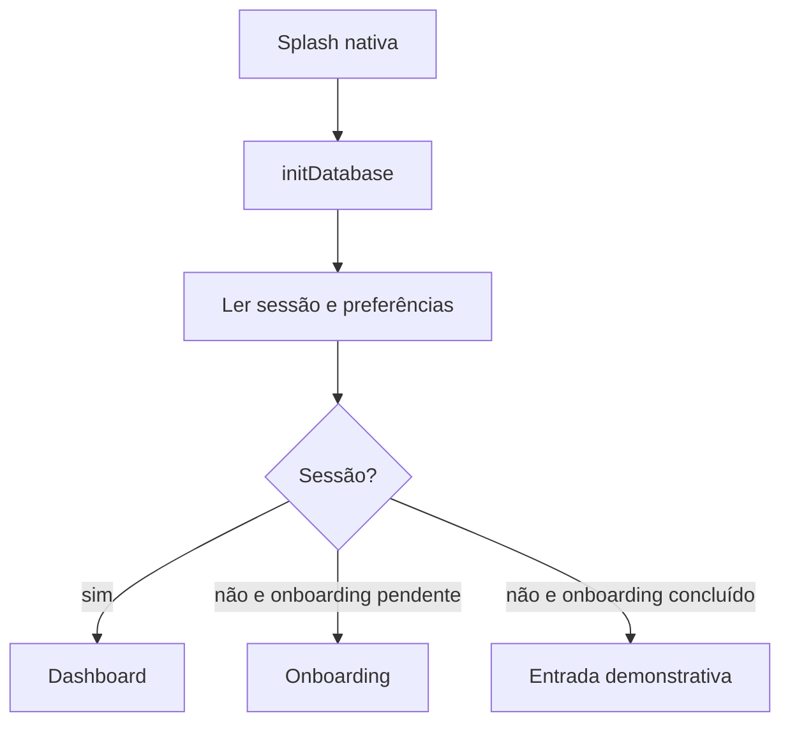
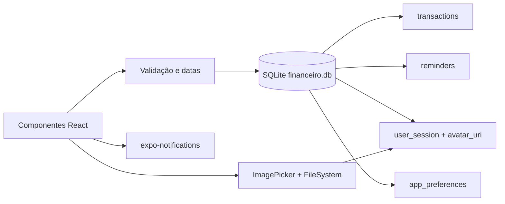

# Arquitetura do aplicativo

## Diretórios
- `App.js`: composição do fluxo e telas do MVP.
- `src/components`: `Avatar` e `DateInput` reutilizáveis.
- `src/database`: SQLite, migração aditiva e operações de domínio.
- `src/services`: notificações e cópia segura de avatar.
- `src/utils`: regras puras de datas e validação.
- `tests`: testes Node de regras sem APIs nativas.

## Inicialização

## Persistência e dados

## Cadastro de transação
1. O formulário recebe a data com máscara brasileira.
2. `validateTransaction` valida e transforma `DD/MM/AAAA` em ISO.
3. `saveTransaction` usa SQL parametrizado.
4. O painel relê a lista e resumo mensal.

## Lembretes
O agendamento é solicitado antes de substituir o identificador persistido. A notificação anterior só é cancelada após a nova ser criada e salva com sucesso. Caso a permissão seja negada, o lembrete ainda é salvo e a interface explica a limitação.
